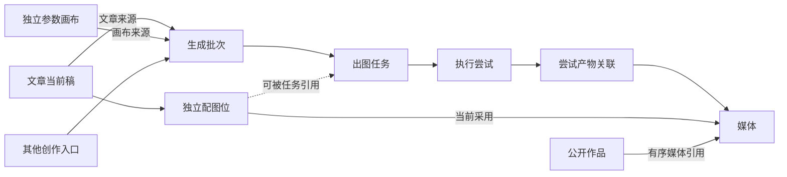

# 创作台逻辑设计与验收（#208）

本文件记录用户确定的业务边界和实现约束。文章服务、独立参数画布、后台批次执行、追加迁移与升级工具已在本地实现；真实多尺寸浏览器验收和最终全量回归状态需以 Issue #208 的实际验证记录为准。本地实现不表示已部署。

文章、单图表单、批量表单和参数画布是独立创作入口。共享执行、媒体和计费能力，不共享表单状态。文章配图不创建或执行画布节点；参数画布只负责参数组合出图。

## 为什么需要调整

改造前 `demo/assets/studio-app.js` 的 `resolveArticleTarget` 优先从活动画布和其他标签找文章节点；`syncPlanNodeToMyArticles` 在特定正文、标题变化时自动创建另一篇文章；`planUnifiedArticleDraft` 创建临时文章图来规划配图。这使文章身份、正文和配图受画布状态影响，与目标业务边界冲突。新文章路径只使用文章存储和独立规划函数；旧节点仅保留一次性提取入口。

现有 PostgreSQL 已有 `studio_articles`、`generation_runs`、`generation_items`、`studio_generations` 和 `media_assets`，保留这些已有实体，不另建一整套生成任务或账本。主要结构调整是增加独立配图位和参数画布，并补齐执行外键。

## 实体及唯一权威

| 实体 | 权威数据 | 关系与边界 |
| --- | --- | --- |
| `studio_articles` | 当前标题、正文、文章默认配图设置 | 属于用户；不保存画布、标签页或节点 ID；不按内容去重 |
| `article_illustrations` | 一处配图的稳定 ID、位置、有效参数、当前采用图片 | 属于文章；一篇文章有多个配图位；不依赖正文中的数组下标标识身份 |
| `studio_canvases` | 当前参数图及节点位置 | 属于用户；不引用文章、单图表单、批量表单或其状态 |
| `generation_runs` | 一次提交的来源、计划数量、参数收据和汇总状态 | 属于用户；可以来自文章、画布或其他入口；文章来源与画布来源互斥 |
| `generation_items` | 本次提交中的稳定出图任务、序号、有效参数与当前执行状态 | 属于批次；文章任务可引用一个配图位；画布任务可保存输出节点标记 |
| `studio_generations` | 一次实际执行尝试、请求幂等键、上游任务、用量与结算关联 | 属于任务；明确失败后重试产生新尝试，网络状态未知时查询原尝试 |
| `generation_attempt_media` | 一次尝试产出的媒体及顺序 | 执行尝试和媒体的关联；支持一个调用返回多张图片 |
| `media_assets` | 媒体身份、所有者、存储键及文件属性 | 文章选图、执行结果和作品均引用媒体 ID；URL 不作为业务主键 |

文章和画布只共享底层执行服务。`source` 继续表达 `web/skill/api` 技术渠道，新增 `creation_mode` 表达 `article/canvas/quick/batch` 业务入口，避免两个概念混用。来源使用明确的可空外键及互斥约束，不使用无法校验外键的通用 `target_type + target_id`。

## 文章：一份当前稿，独立配图

### 保存语义

- 明确“新建”时产生新文章 ID；随后所有自动保存和手动保存都更新这个 ID。
- 两次新建即使标题、正文完全一致也保留两条记录；编辑标题或正文不自动拆出文章。
- 重复发送同一次新建请求由请求幂等键防重；这是网络重放保护，不是按内容合并文章。
- `write_seq` 只是当前行的保存序号，用条件更新检测多标签页覆盖；冲突返回 409 并保留用户未保存内容。不建立历史正文表或历史版本界面。
- 正文保存与任务回调修改不同数据：前者更新文章/配图配置，后者只条件更新执行结果。浏览器不整包回写服务端任务状态。

### 配图位

配图位至少包含：`id`、`article_id`、`role`、`sort_order`、`anchor_json`、`spec_json`、`selected_media_id`、`active_attempt_id`、结果防覆盖序号和软删除时间。

- `role` 为封面或正文配图。正文定位保存标题路径/上下文片段等锚点，不能只保存容易随编辑变化的字符偏移。定位失效时提示待重新定位，保留图片。
- 普通正文保存不重建配图位。用户明确点击重新规划时，保留已确认的配图位和图片；无法匹配的旧位先展示差异，不直接清空成果。
- 重新规划先按稳定 ID，再按唯一语义锚点匹配；封面仅在新旧均为单封面时自动对应。重名或多对多锚点不按数组位置猜测归属。确认界面默认保留未匹配旧位并说明已有采用图片；用户明确取消后才从当前稿移除，已确认列表不会被再次合并恢复。配图位的用户参数、自定义提示词、媒体与结果序号保持独立身份，不建立文章版本历史。
- 文章设置是默认值，配图位可以覆盖画风、图型、比例等参数。提交时把有效参数完整写入任务，之后不再动态读取默认值。
- 封面/正文比例及创作模式、配色、色调、氛围、留白统一从已保存的配图位和文章默认值解析，并参与结果防覆盖哈希。明确的空参数列表可清除继承值。文章请求不能利用旧历史 ID、预设角色图或其他表单参考图改变执行输入；这些解析指令会被移除。
- 改写提示词或重新生成不立即清空当前采用图片。新结果成功且仍有效时才替换；失败继续保留原图。
- 用户手动选图、删除图、修改配图参数、删除配图位或启动新尝试时，使旧结果失去自动覆盖资格。
- 完成回调同时校验当前尝试 ID、配图位防覆盖序号和未删除状态。仅比较参数哈希不足以防止“改动后又改回”及手动选图被旧结果覆盖。
- 尝试与产物记录保留，配图位只存当前采用图片；执行留痕不构成文章版本历史。

文章路径固定为：编辑当前稿 → 规划/调整配图位 → 单张或批量生成 → 选图 → 导出。全过程不创建图节点，不读取画布参数，不修改画布和其他表单。

## 画布：参数组合批量出图

### 节点及组合规则

只设三类节点：

1. **参数节点**：主题、画风方案、图型、比例、参考图组、配色等，每个参数可有多个候选；单候选就是固定参数。
2. **组合节点**：全组合（笛卡尔积）或按行搭配。按行搭配允许长度相同或单值广播，其他长度直接报错；不自动截断、循环补齐或覆盖同名参数。
3. **输出节点**：接收已组合参数，设置每组张数并提供结果预览；可以有多个分支输出。

示例：3 个主题 × 4 种画风 × 2 个比例，每组 2 张，共 48 张。

混合示例：先将 3 个主题与 3 套图型按行配好，再与 4 种画风全组合，得到 12 组；这可以在不同分支采用不同搭配方式。

“两种候选画风”展开成两个方案；“两种画风融合”是一个不可拆的方案。多张参考图组成一组时也作为一个候选，不拆成单图交叉。不同输出节点即使得到相同参数，也保留为不同任务；重复张数由执行产生独立结果，不按提示词去重。

画布保存 `graph_json`（JSONB，包含结构格式号、节点、连线和布局），不把每个节点拆成数据库表。它是整体编辑文档；需要独立查询、并发更新、追踪和结算的运行项则拆成关系表。结构格式号用于解析文档格式，不代表保存历史版本。

允许保存尚未连完的草稿；保存时校验类型和大小，预览和提交时再完整验证可执行性、环路、缺失参数、冲突参数、资源权限和展开数量。

### 提交行为

1. 服务端按确定顺序展开并返回组合表、实际张数及费用/额度信息。默认全选，允许取消部分任务。
2. 用户确认后提交预览摘要及请求幂等键。服务端重新校验权限、输入与费用；预览发生变化时要求重新确认，拒绝执行另一套计划。
3. 在短事务内创建批次和全部任务，保存确认的单价及积分上限，提交后由后台领取执行。额度和积分在每项实际提交时沿用原有事务预留；若免费额度被其他入口消耗，不突破批次确认上限，未执行项保留供重新确认后重试。首期单批上限 200 张，超限提示拆分；不静默少出图。
4. 批次保存有效参数、资源解析结果/指纹、输出节点标记及任务顺序；执行不依赖画布当前状态。付费资源定义仅服务端可见。
5. 刷新或关闭页面后任务继续执行；界面通过批次 ID 查询恢复。编辑、关闭或删除画布不影响已提交批次的执行和账务。
6. 停止批次只阻止未开始任务；已提交上游的任务根据真实状态结算，不把停止界面显示当作上游已取消。失败项单独重试，已成功项不重复扣费。

批次参数收据仅用于执行、恢复和核对，不为画布或文章提供历史版本列表。画布不保存其他入口的 ID，也不自动同步其他入口的字段。

## 后端边界与读取方式

- `studio_articles` 服务负责文章保存、配图规划/选图和删除；`studio_canvases` 服务负责画布草稿、组合编译、预览和提交。
- 统一执行服务负责批次/任务/尝试、幂等、调度、模型调用、结果落库和既有计费；入口只构造任务输入，不各自复制一套扣费和回调逻辑。
- 文章列表只读摘要，进入文章才读取正文及配图；画布列表只读摘要，打开画布才读取图。执行记录按批次分页，不在工作区初始化返回全部历史。
- 列表和批次详情使用批量关联查询；单个详情按所有者约束。执行状态短期缓存可用，文章正文、画布参数和计费均以 PostgreSQL 为权威。
- 外部 AI、图片网关和存储调用不占用写事务或长期持有池连接；后台按租约领取到期任务，避免固定扫描最早一批造成饿死。
- 公开作品继续通过已有作品/媒体投影服务生成，文章正文和参考素材不因生成完成而自动公开；不在本次逻辑重构中改变发布授权策略。

## 数据迁移与切换

1. 追加结构，保持现有文章 ID；从当前 `cards_json` 回填稳定配图位，识别有效的历史媒体引用。无法确认归属的记录保留待核对，不猜测配对。
2. 已存在且 ID 不同的文章继续保留，不按标题、正文哈希或画布来源合并。移除今后的自动拆稿逻辑。
3. 对历史图中的文章节点一次性提取文章当前数据后解除关联。已有纯参数图转换为独立画布；不支持自动转换的旧图保留可导出副本，明确告知用户，禁止静默丢弃。
4. 新文章执行直接引用配图位；新画布只运行组合图。切换后，旧 `cards_json` 和图节点中的文章副本不再作为写入权威；兼容读取必须有明确退出条件。
5. 使用原地更新任务替代当前作品投影中删除再建 `generation_items` 的逻辑，避免破坏任务身份、尝试外键和新增参数。任务序号与一次调用返回的图片序号分开，不继续将二者编码在同一个位置字段里。
6. 历史批次/任务/尝试仅对可确认的关系回填直接外键；未能确认的旧执行保留历史读取，不强造关系。每阶段核对记录数量、所有者、选图和计费一致性。

迁移只向前追加；兼容列和历史数据的物理清理另设任务，不与本次切换同时进行。后续任何兼容代码都不能重新引入文章依赖画布或多份当前稿。

## 升级操作与运行要求

- 新建空库继续使用 `ops/bootstrap_postgres_v3.py`，已注册迁移 118。
- 已有数据库先完成常规备份并暂停旧写入进程。使用数据库所有者连接设置 `HANDRAW_STUDIO_UPGRADE_URL`；运行时连接不会自动被升级工具选中。
- 设置 `HANDRAW_ALLOW_STUDIO_UPGRADE=YES` 后，运行 `python -m ops.upgrade_studio_model --apply --apply-schema`，追加结构并回填当前文章和可确认的终态执行。每批默认 1000，重复执行直到 `articles`、`runs`、`canvases` 为零并核对待处理项；`archivedWorkflows` 统计保留存档，不要求归零。普通 `python -m ops.upgrade_studio_model` 只检查，不写数据。
- 升级报告中的 `issues` 只含记录 ID 和原因，不含正文、私有参数或凭据；执行中的记录等待旧任务终态再处理，不强行绑定到某篇文章。无原文件的旧导入任务按旧恢复策略报失败，有持久化输入和有效租约的任务不受其他进程启动影响。
- 文章的 `illustrations_ready` 标记权威切换：完成切换后配图只从 `article_illustrations` 读取，新保存不再往 `cards_json` 写一份运行状态。旧副本保留用于升级核对；删除最后一处配图不会从旧 JSON 恢复。
- 导入输入放在 `HANDRAW_PRIVATE_STORAGE/import_inputs`，不位于上传公开命名空间；写入使用原子替换和 SHA-256 校验。多个进程必须共享该私有存储。终态输入及时清理，未被数据库引用的中断暂存文件延迟清理。
- 应用主进程启动 `CanvasDispatcher` 和现有生成协调器。数据库任务、尝试、预留和账本是执行权威；浏览器缓存只保存按账号隔离的草稿及待确认请求键。未知提交复用原请求键，刷新不重做已接受批次。
- 参数画布 JSON 不包含付费定义。服务端计划保存执行所需的资源收据，前端只收到资源编号、用户参数、计划数量和费用。执行时重新校验资源权限，但不切换为后续编辑的资源定义。
- 新批次任务使用普通序号；媒体产物另存 `generation_attempt_media.ordinal`。旧多图编码行以 `retired_at` 退出活动任务列表，原行和外键保留，历史账务不改写。
- 生成历史先按批次游标分页，再批量读取该页执行与产物，不以最近若干条执行截断历史。画布与画布批次同样提供连续游标。前端按需加载更早记录，刷新可恢复之前选中的画布和批次；本地历史预热缓存只保存最近 40 批，不限制服务端历史或当前页面已载入记录。
- 历史画布入口只打开对应画布与执行批次，不再恢复、修改旧表单图。画布已删除时仍可读取批次结果；旧表单的保存与缩放浮动控件不会出现在独立参数画布上。
- 媒体清理同时检查当前文章选图、文章/画布参考图、任务参数和尝试产物，不再依靠文章旧 JSON 副本判断引用。保留失败优先于误删正在使用的文件。

## 数据权威

画布默认使用「搭配视图」：准备主题与图片参数、选择全部互搭或按顺序搭配、预览张数和费用后确认生成。添加参数会自动接入当前搭配；同类参数继续在原卡中添加候选，避免误建同类节点。单值在每组中复用，双画风保持为一套候选。数量提示用于编辑反馈，实际计划及费用仍由服务端核验。参数变更立即撤销旧预览和费用确认。

「自由连线」保留嵌套组合、多输出和节点移动；存在独立连线或复杂结构的旧画布直接打开自由视图，不自动压平。两种视图读取同一份参数图，不复制成其他表单。手机提供步骤跳转，移除参数或候选可在下一次编辑前撤销；生成确认在页面内展开，提交不依赖浏览器原生确认框。

- `studio_articles` 保存一份当前稿，相同内容的不同 ID 是不同文章。`write_seq` 只防止并发覆盖，不保存历史正文。
- `article_illustrations` 保存稳定配图位、定位、参数及当前采用媒体。生成失败保留原图，已删除/改动配图位不能被晚到结果恢复。
- `studio_canvases` 保存参数图 JSON，与文章/其他表单无关联。服务端校验并展开全组合、按行搭配、固定参数，最多 200 项，超限拒绝，不截断。
- `generation_runs` 是一次提交；`generation_items` 是稳定计划项；`studio_generations` 是关联到计划项的执行尝试和计费记录。未知请求复用原请求 ID，明确失败的主动重试创建新尝试。
- `media_assets` 是媒体身份；配图位、执行产物、作品引用媒体 ID。URL 只是访问地址。公开作品沿用现有一批次一作品规则，文章正文和未提交素材保持私有。
- 批次提交时冻结参数；后续编辑画布不修改已提交批次。参数快照不是文章/画布的版本历史。

## 实施顺序

1. 追加 PostgreSQL 结构、独立文章保存和配图位，修复并发保存；同内容新建两次保留两个 ID。
2. 直接关联执行尝试与批次/计划项，绑定文章配图位及画布来源，结果用条件更新应用。
3. 独立参数画布保存、服务端展开和批次提交；前端切断文章/表单与画布联系。
4. 工作区批量读取与分页、外部调用释放连接、公平调度、导入租约与持久化输入。
5. 隔离 PostgreSQL 并发/事务/HTTP、真实多尺寸浏览器、全量回归、查询次数和清理检查。

## 不变量

- 文章不存在版本历史表，不按正文或标题去重。新建与保存分别使用新 ID/原 ID；网络重放依赖请求幂等，不依赖内容去重。
- 配图位只有当前有效尝试能自动更新选图；移除、编辑或重新生成后，旧回调不能覆盖当前内容。
- 独立执行尝试保留其原始输入与计费；选择/删除图片不删除账本。
- 当前采用图片与正在执行的尝试是两件事；重新生成失败不能使原图丢失，手动选图也不能被晚到回调覆盖。
- 图结构支持资源候选与融合方案区分：候选是多个值，融合方案是一个值；参考图组也是一个参数值。
- 配对输入长度必须相同或为 1（广播）；固定参数为单值。存在环路、无效资源、缺失值或超过 200 项时不创建任务、不扣费。
- 模型和对象存储调用期间不占写事务，连接不因外部等待长期占用；任务领取和最终提交通过数据库条件与租约保护。

## 关键验收场景

- 相同标题正文新建两次得到两个文章 ID；同 ID 改写百次仍只有一份当前稿；两个标签同序号保存只有一个成功。
- 空画布、关闭画布和其他表单有未保存内容时，文章都能独立保存、规划和出图，且不会改变这些入口。
- 画布固定值、交叉、逐行、嵌套组合、多输出、重复张数的预览与任务逐项相同；不合法和超限计划不创建任务、不扣费。
- 同批次重复提交、同尝试重复回调不重复出图/计费；主动重试仅涉及失败项。刷新/关闭页面不会中断后台调度。
- 配图生成期间发生参数改回、手动选旧图、删除位、删除文章以及旧回调晚于新回调时，不覆盖当前选择或恢复已删除数据。
- 升级前后文章/媒体/账务归属可核对，旧图不会静默丢失；作品投影不删除任务身份，不泄露文章正文或付费定义。

## 本地验证与剩余验收

- PostgreSQL/Redis 隔离环境的六分片全部通过；因执行期间新增模块改变了分片分配，另补跑 80 项并按实际测试 ID 核对，1040 个用例均已覆盖，没有遗漏或测试跳过。分页阶段新增 3 个后端用例后，另运行 74 项历史/权限/生成/退款/媒体回归和最终 22 项画布/分页/真实 HTTP 验证，全部通过；本阶段未重新声称在最终提交上运行过六分片。日志位于忽略目录 `.local/issue-208-full-final/`、`.local/issue-208-coverage-repair.log`、`.local/issue-208-history-regression.log` 和 `.local/issue-208-history-final.log`。
- 文章保存/生成、账号隔离和历史分页的前端行为验证为 24 项；参数画布草稿、并发保存、提交恢复、历史恢复、导航竞态与费用状态为 12 项。CI 配置引用的 34 个 JavaScript 检查脚本均执行通过；文章规划、配图确认、删除及预览导航相关检查也已执行。按实际测试 ID 汇合六分片、补跑和专项日志后，当前 1043 个 Python 用例均有执行记录，未遗漏。
- 工作区 2 条与 400 条执行记录、120 个批次均为 11 条 SQL；新初始化只读摘要，数据库验证为最多 3 条 SQL。122 篇文章跨摘要页遍历无重复遗漏，正文在单篇详情中读取。
- 在已有 pre-118 隔离库实际执行升级命令：未安装结构时只读检查报未准备；`--apply --apply-schema` 成功回填一篇文章；再次检查及重复应用均无新增迁移数据，正文不变。
- 连续翻页验证覆盖同时间排序的 120 个历史批次、一个批次额外 405 条执行、105 个画布和 45 个画布批次；真实 HTTP 验证首/续页、无效游标、所有者隔离及尚未开始执行的画布批次。前端验证 80 条记录不会因本地缓存上限而丢失，并验证失败重试、旧画布/旧批次刷新恢复和账号切换晚到响应。
- 真实浏览器此前因工具不可用而受阻；2026-11-13 内置浏览器恢复后，已补做 1440/820/390 宽度操作和截图核验。内置浏览器完成登录、文章保存/规划/配图及画布搭配预览；其原生确认框处理受限，因此按用户授权用 CDP 9221 完成画布确认提交、四项后台生成及刷新恢复。隔离服务使用模拟图片网关，验证实际 HTTP、PostgreSQL、调度和计费流程，不代表真实模型质量或生产验收。
- 旧 `test_v2_studio_state.cjs` 曾在图片加载间隔的过期源码断言（期望 40，实现 24）失败。后续 #211 用实际请求发起节奏和并发上限验证替代该断言，并修正缩略图测试夹具为受支持的媒体路径，完整状态脚本通过并加入 CI；产品加载实现不变。当前 CI 引用的 36 个 JavaScript 脚本全部通过，日志为 `.local/issue-211-js-ci.log`。配置的 DeepSeek 接口检查返回 `URLError`，本次没有取得 DeepSeek 审阅结果。
- 后续 #209 先复现默认比例未生效、旧比例结果覆盖当前选图的两个失败用例，再补齐保存参数权威。37 项后端（含真实 HTTP、升级、权限、画布执行和查询预算）及 25 项文章前端行为验证通过；日志为 `.local/issue-209-final.log` 和 `.local/issue-209-state-final.log`，没有扩大为最终全量回归结论。
- 后续 #210 补齐重新规划的图位匹配、成果保留与显式移除。8 项行为验证覆盖语义锚点移动、重名歧义、原图与参数保留、确认取消、显式移除、超过 200 位时要求调整选择，以及真实当前稿应用函数不修改其他表单图。CI 引用的 35 个 JavaScript 脚本通过，日志为 `.local/issue-210-js-ci.log`。该结果仍不代替真实多尺寸浏览器验收。
- 最终全量首次使用固定 1046 用例清单执行六分片：五片通过，一片中的慢响应体超时测试在并行负载下耗时约 640ms，超过原 600ms 上限；当时客户端日志记录约 218ms 已识别超时。#212 修复超时路径无条件同步格式化堆栈的问题，改为遵循既有调试配置；没有放宽实际 HTTP 测试阈值。AI 客户端/日志模块 23 项通过。按首次失败分片的原 22 个模块完整复跑，新增日志行为用例使该分片为 196 项，全部通过。合并其余五片后逐项核对当前清单：1047 个唯一 Python 用例均有通过记录，无遗漏、重复或跳过。首次失败没有被覆盖或称为通过；日志为 `.local/issue-208-release-full/`、`.local/issue-212-shard2.log`，覆盖审计为 `.local/issue-208-release-audit.json`。
- 本轮浏览器验收补充：同标题、同正文通过「新建」保存为两个不同 ID，刷新后仍独立；文章重新规划确认后保留原封面；切回单图后原主题不变。画布两主题、两画风的交叉预览为 4 项，按行搭配为 2 项、每组重复两次为 4 项；实际批次完成 4/4，刷新恢复同批次和结果。桌面、平板、手机核验文章和画布，页面宽度分别为 1440/820/390，无整页横向溢出，参数图内保留必要的滚动。
- 实际页面发现并修复 #213 的高节点整理重叠、#214 的演示空账号误生文章冲突、#215 的摘要显示演示正文及错误配图总数；同时修正 #210 重规划确认框的过期移除提示。修复后在页面复验：节点行距按实际高度；游客演示样本不进入登录账号，空账号新建并刷新恢复真实正文；文章摘要显示实际 1/3，删除图位不计入总数。摘要仍不返回正文。
- 本轮最终执行 36 个 CI JavaScript 脚本全部通过（含文章行为 29 项、参数画布 13 项）；摘要查询与真实 HTTP 共 10 个 PostgreSQL 用例通过，查询仍为小/大数据各 11 SQL、初始化最多 3 SQL。日志为 `.local/issue-215-js-ci.log`、`.local/issue-215-python.log`。新增一个后端用例，本轮未重跑完整六分片。截图位于忽略目录 `.local/issue-208-browser/screenshots/`，包括 `article-final-1440.jpg`、`article-820.jpg`、`article-390.jpg`、`canvas-final-1440.jpg`、`canvas-fixed-820.jpg`、`canvas-results-390.jpg`、`articles-summary-fixed-390.jpg` 和 `demo-save-fixed.jpg`。

## 最终验收状态

| 要求 | 当前证据 | 结论 |
| --- | --- | --- |
| 文章一份当前稿，相同内容不同 ID 独立 | `test_studio_model`、`test_article_versions` 的真实 PostgreSQL 并发/保存检查 | 自动验证通过 |
| 文章独立配图，参数只来自保存内容 | `test_studio_model_http`、`test_studio_model`、25 项前端文章状态行为 | 自动验证通过 |
| 画布固定、交叉、按行、嵌套、多输出与重复出图 | `test_studio_canvases`，非法计划和确认摘要变化时不建任务 | 自动验证通过 |
| 批次、任务、尝试和媒体身份，幂等、重试与计费 | `test_canvas_dispatcher`、`test_generation_v3`、退款/并发回归 | 自动验证通过 |
| 修改、删除、手动选图、重规划不被晚到结果覆盖 | `test_studio_model` 与 8 项 `test_article_replanning.cjs` 行为 | 自动验证通过 |
| 连接释放、公平调度、导入持久化与租约 | `test_studio_scheduling`、`test_import_durable_jobs` 的多工作进程/恢复检查 | 自动验证通过 |
| 查询预算、连续翻页、账号缓存隔离 | 初始化最多 3 SQL；2/400 执行均 11 SQL；文章/画布/历史游标、36 个 CI JS 脚本 | 自动验证通过 |
| 追加结构、既有数据保留和可重复升级 | 当前代码再次实际执行 pre-118 升级 CLI，四次命令结果符合预期，原正文不变 | 自动验证通过 |
| 回归覆盖 | 前阶段 1047 个 Python 用例按 ID 核对；本轮新增摘要用例后，10 个相关 PostgreSQL/HTTP 回归及 36 个 CI JS 脚本通过 | 自动验证通过，未声称本轮重跑六分片 |
| 1440/820/390 实际浏览器交互与视觉 | 内置浏览器操作、CDP 9221 提交和结果恢复、多尺寸截图及修复后复验 | 本地隔离环境通过，图片网关为模拟实现 |

本地实现、自动验证及多尺寸浏览器验收已完成。真实模型质量、生产迁移与发布属于部署阶段；没有推送、部署或使用生产数据库。

生产数据库不用于验收。迁移只向前追加，代码回退不回滚数据库。提交、推送和部署分别报告，不把本地测试视为生产发布。
