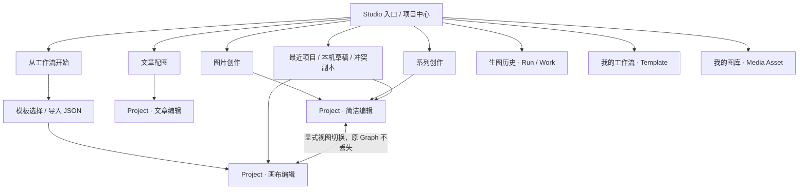

# Studio 2.0 · Issue #106 导航与项目中心实施说明

关联：[Issue #106](https://github.com/yang0/handraw-web/issues/106) · [Epic #101](https://github.com/yang0/handraw-web/issues/101) · [Draft PR #131](https://github.com/yang0/handraw-web/pull/131)

## 信息架构

三种 **创作任务** 是图片创作、系列创作、文章配图。**从工作流开始** 是另一种进入项目的途径，而不是第四种任务类别。**简洁编辑 / 画布编辑** 是一个项目的编辑视图切换；不创建新的 Project、Run 或 Graph 权威。**项目中心、我的工作流、生图历史、我的图库** 是分别管理项目、模板、生成结果和个人素材的入口。

## 路由与兼容约定

| 旧/深链参数 | 处理与保真 |
| --- | --- |
| `?entry=quick` | 图片创作简洁编辑 |
| `?entry=batch` | 系列创作简洁编辑 |
| `?entry=article` | 文章编辑，保留 `articleId` 等文章上下文 |
| `?entry=canvas` | 画布编辑；按当前项目保持 Graph 权威 |
| `?view=projects` | 项目中心，加载当前账号可见项目 |
| `?project={id}` | 读取云端项目；恢复成功后 URL 同时保留 `project` ID |
| `?view=history` | 生图历史，独立于任务类型 |
| `?view=workflows` | 工作流模板与导入页面 |
| `?workflow={id}` | 已保存模板创建工作区并保留来源 ID；未知 ID 明示错误而非默默创建空白图 |
| `?fork={id}` / `?remix={id}` | 复用同一作品配方加载流程，完成后保存 `sourceRemix` 来源；失败保持可重试的原链接 |

## 项目卡与恢复优先级

- 云端项目明确显示“云端已保存”、权威类型、版本与更新时间。
- 本机待同步草稿与云端卡区分显示；冲突副本另列，不自动覆盖本机。
- 恢复以已存在的本机未同步草稿/冲突副本为先，避免旧云端响应覆盖工作；CAS/Outbox 与账号隔离仍由 #103 机制负责。
- 项目中心搜索使用服务端标题搜索、40 条游标分页、旧请求版本失效机制；IME 组合输入结束后才发搜索，保持输入焦点、选区和滚动位置。

## 视口与交互验收

- 桌面（1366px）：三类任务、工作流入口、当前项目标题和保存状态显示；资产/历史折叠单独管理。
- 平板（768px）及手机（360px）：导航抽屉收起/展开，按钮可触摸；项目创建卡换行，冲突卡与搜索保持可读。
- 屏幕阅读器：任务导航、项目视图切换、抽屉开关、搜索栏有角色或标签，选中态通过 `aria-pressed` / `aria-expanded` 显示。
- 支持 reduced-motion；不在此 Issue 改写图像生成逻辑。

## 自动验收

`tests/smoke_studio_navigation_projects_106.py` 使用本地独立 SQLite + 本地 HTTP 服务 + GitHub runner 真 Chromium：验证四入口、项目中心 cursor 分页与中文搜索、URL 兼容（含 Project / Remix / Workflow）、项目视图切换及 360/768px 抽屉。Remix 的配方响应使用浏览器拦截本地 mock；**不调用真实计费生图接口**。截图和 JSON 结果在 `artifacts/navigation-106-screen/`，由 `interaction-journey-regression` 上传。
